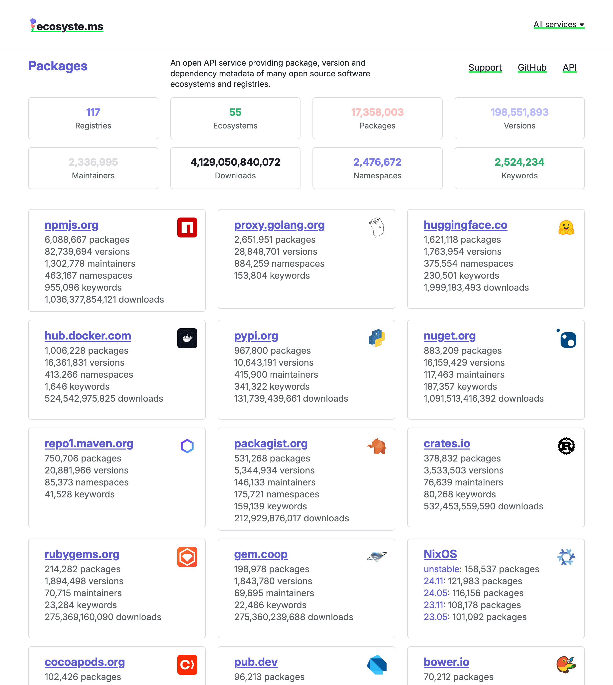
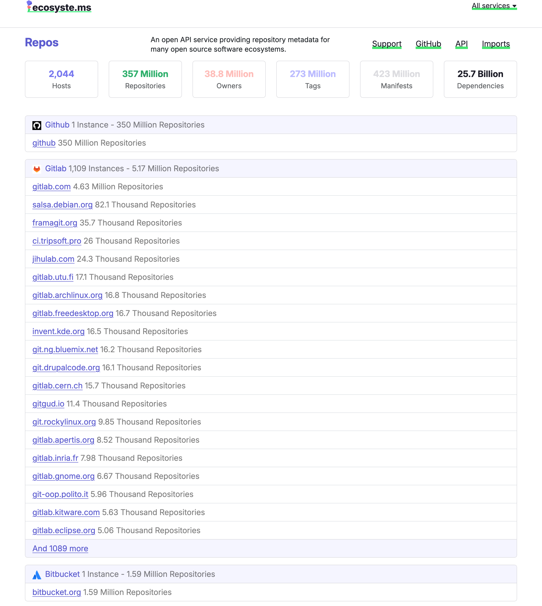
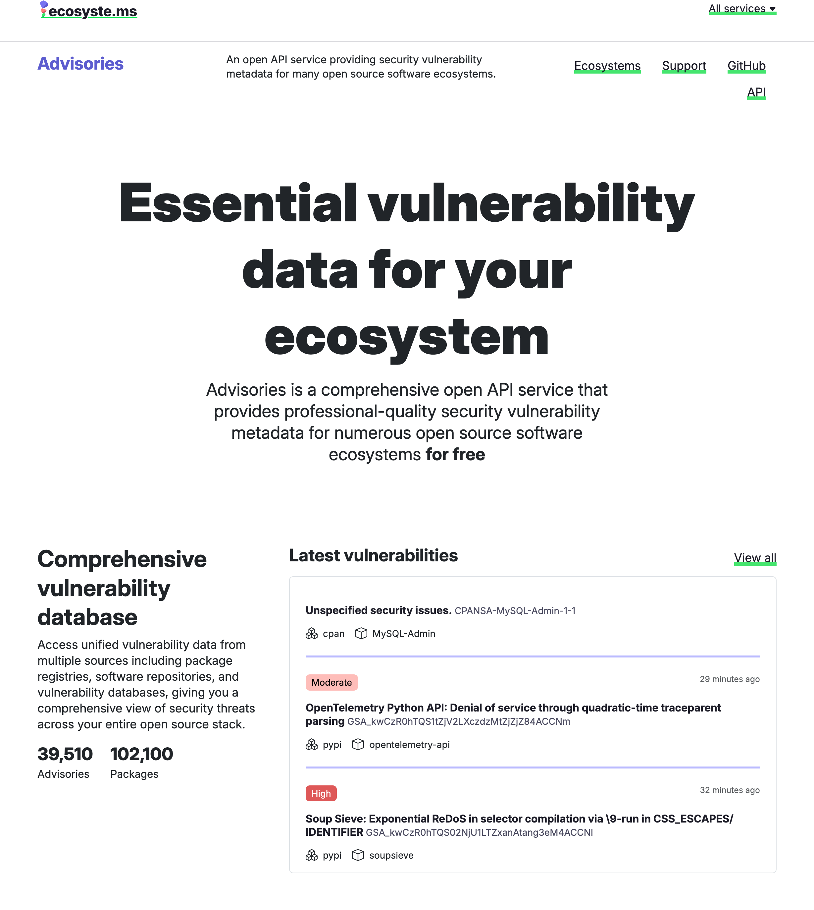
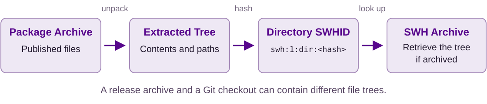
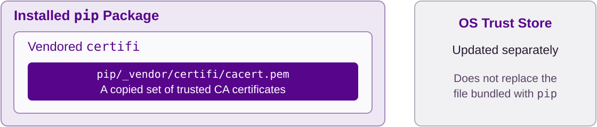

<!-- _class: lead -->
<!-- _paginate: false -->
<!-- _footer: '' -->

# Ten Years of<br>Mapping Open Source

Lessons for Supply Chain Security

Andrew Nesbitt

NYU · 16 November 2026

---

# Abstract

Package registries, dependency files, and source repositories contain different information about the same software. Drawing on ten years of building Libraries.io and ecosyste.ms, we’ll look at how to combine those records and use them for supply chain security.

---

# Outline

- Ten Years of Asking Questions About Open Source
- An Overview of ecosyste.ms
- Package Manager Tradeoffs
- Package Management Is Naming All the Way Down
- Applying Ecosystem Data
- Pitfalls of Using Open Source Data
- References

<!-- - Identifying Software and Its Dependencies -->

---

# Andrew Nesbitt

- Building ecosyste.ms; previously built Libraries.io
- A decade working on package management and open source metadata
- Working for Alpha-Omega on open source software security
- Projects include Homebrew Bundle, Octobox, and 24 Pull Requests

<!-- _class: source -->

[https://nesbitt.io](https://nesbitt.io) · [https://github.com/andrew](https://github.com/andrew)

---

# Why I'm Fascinated by Package Management

- Game updates bring new maps, bug fixes and performance improvements
- `gem update` on my Rails apps made them better without me doing anything
- I liked Bundler and `Gemfile.lock` so much I made it for Homebrew: [Brewfile](https://docs.brew.sh/Brew-Bundle-and-Brewfile)

<!-- _class: source -->

[https://nesbitt.io/2025/12/09/why-im-fascinated-by-package-management.html](https://nesbitt.io/2025/12/09/why-im-fascinated-by-package-management.html)

---

# How I Started Collecting Open Source Data

- Started [24 Pull Requests](https://24pullrequests.com) in 2012, needed a way to recommend projects
- Built [Libraries.io](https://libraries.io) as a cross-registry package search engine
- Built [ecosyste.ms](https://ecosyste.ms) as an open API for package metadata
- Needed a way to rank projects without relying on GitHub stars or downloads
- Found dependent counts useful for measuring usage across ecosystems

---

# Widely Used Projects With Little Visibility

- In 2017 [`debug_inspector`](https://github.com/banister/debug_inspector) had 25 stars and 111,000 public dependent repositories
- In 2026 [`debug_inspector`](https://github.com/banister/debug_inspector) has 60 stars and 550,000 public dependent repositories
- GitHub attention and dependency usage measure different things
- Discovery work exposed widely used projects receiving little attention

<!-- _class: source -->

[https://nesbitt.io/2017/02/24/exploring-unseen-open-source-infrastructure.html](https://nesbitt.io/2017/02/24/exploring-unseen-open-source-infrastructure.html)

---

# Mining Dependencies

- Package dependencies: registry data from rubygems.org, npmjs.org, and pypi.org
- Repository dependencies: data from dependency files in public repositories
    - Manifests: `package.json`, `Gemfile`, `requirements.txt`, `go.mod`
    - Lockfiles: `package-lock.json`, `Gemfile.lock`, `pylock.toml`, `Cargo.lock`

---

<!-- _class: lead -->

# An Overview of ecosyste.ms

---

# ecosyste.ms

- Open APIs connecting packages, repositories, dependencies, and funding
- All open source: Ruby on Rails, PostgreSQL, and Redis
- About 9.8 TB across 25 live PostgreSQL databases
- About 44 billion rows, including 28 billion dependency records
- Around 1.7 billion requests per month

<!-- _class: source -->

[https://ecosyste.ms](https://ecosyste.ms)

---

# [packages.ecosyste.ms](https://packages.ecosyste.ms)

- Explore releases, dependencies, and links to source repositories
- 17.5 million packages across 117 registries
- 199 million versions across 55 ecosystems



<!-- _class: source screenshot -->

[https://packages.ecosyste.ms](https://packages.ecosyste.ms)

---

# [repos.ecosyste.ms](https://repos.ecosyste.ms)

- Connect development projects to their published packages
- 357 million repositories across 2,044 hosts
- 423 million manifests and 25.7 billion dependency records



<!-- _class: source screenshot -->

[https://repos.ecosyste.ms](https://repos.ecosyste.ms)

---

# [advisories.ecosyste.ms](https://advisories.ecosyste.ms)

- Connect affected packages and versions to vulnerability records
- About 39,600 security advisories
- Metadata for about 102,500 packages



<!-- _class: source screenshot -->

[https://advisories.ecosyste.ms](https://advisories.ecosyste.ms)

---

# Dependency Tools

- [Parser](https://parser.ecosyste.ms): dependency metadata from manifests and lockfiles
- [Resolver](https://resolve.ecosyste.ms): dependency trees for packages
- [SBOM Parser](https://sbom.ecosyste.ms): parse and convert software inventories

<!-- _class: source -->

[https://ecosyste.ms/#tools](https://ecosyste.ms/#tools)

---

# [Archives](https://archives.ecosyste.ms) and [Diff](https://diff.ecosyste.ms)

- Inspect files inside published packages
- Compare package contents between releases

<!-- _class: source -->

[Archives](https://archives.ecosyste.ms) · [Diff](https://diff.ecosyste.ms)

---

# Activity Indexes

- [Timeline](https://timeline.ecosyste.ms), [Commits](https://commits.ecosyste.ms), and [Issues](https://issues.ecosyste.ms) expose development activity
- [Dependabot](https://dependabot.ecosyste.ms) tracks automated update pull requests
- [Timeline](https://timeline.ecosyste.ms): about 2.7 billion stored GitHub events
- [Commits](https://commits.ecosyste.ms): 1.53 billion commits across 8.9 million repositories
- [Issues](https://issues.ecosyste.ms): 50.8 million issues and 156 million pull requests

<!-- _class: source -->

[Timeline](https://timeline.ecosyste.ms) · [Commits](https://commits.ecosyste.ms) · [Issues](https://issues.ecosyste.ms)

---

# Funding Data and [Funds](https://funds.ecosyste.ms)

- [Sponsors](https://sponsors.ecosyste.ms) and [Open Collective](https://opencollective.ecosyste.ms) index financial support
- [Funds](https://funds.ecosyste.ms) supports dependencies at the ecosystem level
- About 308,000 sponsorship records and 7.3 million transaction records

<!-- _class: source -->

[https://funds.ecosyste.ms](https://funds.ecosyste.ms)

---

# [Dashboards](https://dashboards.ecosyste.ms) and Research Applications

- [Dashboards](https://dashboards.ecosyste.ms) provides data on contribution activity and impact
- [Science](https://science.ecosyste.ms) and [Papers](https://papers.ecosyste.ms) connect software with research
- [Search](https://search.ecosyste.ms) and [Awesome](https://awesome.ecosyste.ms) support discovery
- [Papers](https://papers.ecosyste.ms) stores about 498,000 software mention records

<!-- _class: source -->

[https://ecosyste.ms/#applications](https://ecosyste.ms/#applications)

---

<!-- _class: lead -->

# Package Manager Tradeoffs

---

# Package Metadata and Identity

- Full index replication vs on-demand queries
  - `apt` vs npm registry
- Single registry vs multiple registries
  - RubyGems vs Maven
- Flat vs scoped vs hierarchical namespaces
  - RubyGems vs npm scopes vs Maven group IDs
- Central registry vs external identifier
  - npm registry names vs Go module paths
- Semver format vs arbitrary strings vs enforced semantics
  - npm vs `dpkg` vs Elm

<!-- _class: source tradeoffs compact -->

[https://nesbitt.io/2025/12/05/package-manager-tradeoffs.html](https://nesbitt.io/2025/12/05/package-manager-tradeoffs.html)

---

# Distribution and Publishing

- Source distribution vs binary distribution
  - Cargo and Go source packages vs PyPI wheels and Maven JARs
- Single artifact vs platform matrix
  - Cargo crates vs PyPI wheels for each Python version, ABI, and platform
- Explicit publish step vs pull from source
  - `npm publish` vs Go module tags
- Open publishing vs gated review
  - npm and PyPI vs Debian and Homebrew
- Build hooks allowed vs forbidden
  - npm `postinstall` and Cargo `build.rs` vs Go
- Registry-managed signing vs author-controlled signing
  - npm registry signatures vs Debian maintainer GPG signatures

<!-- _class: source tradeoffs compact -->

[https://nesbitt.io/2025/12/05/package-manager-tradeoffs.html](https://nesbitt.io/2025/12/05/package-manager-tradeoffs.html)

---

# Resolution and Updates

- One version vs many versions retained
  - Homebrew vs language registries such as npm
- Maximal vs minimal version selection
  - Most package managers, including npm, vs Go modules
- Fail on conflicts vs allow multiple versions
  - `pip` vs npm's nested dependencies
- Yanking vs full deletion
  - Cargo yanking vs npm deletion with time limits
- System-wide vs per-project installation
  - `apt` vs Bundler and Cargo
- Coordinated releases vs rolling updates
  - Debian stable vs Arch Linux

<!-- _class: source tradeoffs compact -->

[https://nesbitt.io/2025/12/05/package-manager-tradeoffs.html](https://nesbitt.io/2025/12/05/package-manager-tradeoffs.html)

---

<!-- _class: lead -->

# Package Management Is<br>Naming All the Way Down

---

# Package Name Restrictions

- PyPI: `my-package`, `my_package`, `My.Package`, and `MY_PACKAGE` are equivalent
- npm: new names must be lowercase; legacy names include `JSONStream`
- NuGet: case-insensitive IDs, so `Newtonsoft.Json` and `newtonsoft.json` match
- Unicode: Cargo allows Unicode letters and digits; PyPI and crates.io require ASCII
- crates.io: `-` and `_` cannot distinguish names; `nul` is reserved

<!-- _class: source example -->

[Blog post](https://nesbitt.io/2026/03/03/package-management-is-naming-all-the-way-down.html) · [PyPI](https://packaging.python.org/en/latest/specifications/name-normalization/) · [npm](https://docs.npmjs.com/cli/v11/configuring-npm/package-json/) · [NuGet](https://learn.microsoft.com/en-us/nuget/reference/nuspec) · [Cargo](https://doc.rust-lang.org/cargo/reference/registry-index.html#name-restrictions)

---

# Package Namespaces

- Flat names: RubyGems `rails`, PyPI `requests`, crates.io `serde`
- Optional scopes: npm `express` and `@babel/core`
- Required vendor namespaces: Packagist `symfony/console`
- Reverse-domain names: Maven Central `org.apache.commons:commons-lang3`
- Repository paths: Go `github.com/gorilla/mux`
- Reserved prefixes in a flat namespace: NuGet `Microsoft.*`

<!-- _class: source example -->

[https://nesbitt.io/2026/02/14/package-management-namespaces.html](https://nesbitt.io/2026/02/14/package-management-namespaces.html)

---

# Versioning Schemes

- SemVer: `2.4.1` (major, minor, patch)
- CalVer: `2026.11.16` (release date)
- ZeroVer: `0.8.3` (major version stays at zero)
- EffVer: `2.1.0` (effort required to adopt an update)
- HashVer: `2020.01.67092445a1abc` (date and commit hash)
- SoloVer: `42` or `42+hotfix` (release counter)
- PVP: `1.2.3` (`1.2` is major, `3` is minor)
- AsymptoVer: `3.1`, `3.14`, `3.141` (TeX versions approaching pi)

<!-- _class: source example -->

[https://nesbitt.io/2024/06/24/from-zerover-to-semver-a-comprehensive-list-of-versioning-schemes-in-open-source.html](https://nesbitt.io/2024/06/24/from-zerover-to-semver-a-comprehensive-list-of-versioning-schemes-in-open-source.html)

---

# Dependency Requirements

- Exact pin (Python): `==1.2.3`
- Minimum version (Python): `>=2.28`
- Bounded range (Python): `>=2.0,<3.0`
- Pessimistic constraint (Ruby): `~> 2.0`
- Caret range (npm): `^2.0`
- Optional extras (Python): `requests[security]`
- Scoped package with a range (npm): `@types/node@^18.0.0`

<!-- _class: source example -->

[https://nesbitt.io/2026/03/03/package-management-is-naming-all-the-way-down.html](https://nesbitt.io/2026/03/03/package-management-is-naming-all-the-way-down.html)

---

# Platform Strings

ARM64 macOS across ecosystems:

- LLVM: `aarch64-apple-darwin`
- Go: `darwin/arm64`
- npm binary packages: `darwin-arm64`
- Python wheels: `macosx_11_0_arm64`
- RubyGems: `arm64-darwin`
- vcpkg: `arm64-osx`
- .NET: `osx-arm64`
- Nix: `aarch64-darwin`

<!-- _class: source example -->

[https://nesbitt.io/2026/02/17/platform-strings.html](https://nesbitt.io/2026/02/17/platform-strings.html)

---

# Typosquatting

- Omission: `reqests` instead of `requests`
- Repetition: `requestss` instead of `requests`
- Transposition: `reqeusts` instead of `requests`
- Replacement: `requezts` instead of `requests`
- Homoglyph: `reque5ts` instead of `requests`
- Delimiter: `crossenv` instead of `cross-env`
- Word order: `nmap-python` instead of `python-nmap`
- Combosquatting: `lodash-utils` resembling an official `lodash` extension

<!-- _class: source example -->

[https://nesbitt.io/2025/12/17/typosquatting-in-package-managers.html](https://nesbitt.io/2025/12/17/typosquatting-in-package-managers.html)

---

# Dependency Confusion

The same package name can exist in a private and a public registry:

| Source | Package | Version |
| --- | --- | --- |
| Private registry | `acme-utils` | `1.2.0` |
| Public registry, published by an attacker | `acme-utils` | `99.0.0` |

- Depending on registry configuration and version constraints, the public version may be installed
- Bind private package names or scopes to an explicit registry

<!-- _class: source example -->

[https://nesbitt.io/2025/12/10/slopsquatting-meets-dependency-confusion.html](https://nesbitt.io/2025/12/10/slopsquatting-meets-dependency-confusion.html)

---

# Slopsquatting

- Generated code can include package names that do not exist
- Attackers collect repeated suggestions and register those names
- Later installations can download the attacker's package
- Plausible names such as `payments-core` can also overlap with private packages
- Check the package, publisher, and source before installing generated dependencies

<!-- _class: source example -->

[https://nesbitt.io/2025/12/10/slopsquatting-meets-dependency-confusion.html](https://nesbitt.io/2025/12/10/slopsquatting-meets-dependency-confusion.html)

<!--

---

&lt;!-- _class: lead --&gt;

# Identifying Software<br>and Its Dependencies

---

# Tracing Installed Software to Source

- Go build metadata can include the commit, commit time, and local changes:

```sh
go version -m ./app
```

Look for `vcs.revision`, `vcs.time`, and `vcs.modified`.

- Composer retains the source or distribution reference of an installed package:

```php
echo \Composer\InstalledVersions::getReference('vendor/package');
```

- Building without VCS metadata can leave only a release version to trace.

&lt;!-- _class: source example --&gt;

[https://nesbitt.io/2026/04/07/who-built-this.html](https://nesbitt.io/2026/04/07/who-built-this.html)

---

# Identifying and Preserving Source Code

- Package coordinates contain the ecosystem, package name, and version
- Repository URLs are locations; SWHIDs are content-derived identifiers
- Archived source can be retrieved after the original repository is removed



&lt;!-- _class: source example --&gt;

[https://nesbitt.io/2026/10/01/software-heritage-identifiers.html](https://nesbitt.io/2026/10/01/software-heritage-identifiers.html)

---

# Dependencies Missing From Manifests

- `pip` includes a vendored copy of `certifi` and its CA bundle
- Updating the system trust store leaves that bundled file unchanged
- Finding the roots an application uses requires inspecting files and runtime configuration



&lt;!-- _class: source example --&gt;

[https://nesbitt.io/2026/10/21/trust-stores-are-dependencies-too.html](https://nesbitt.io/2026/10/21/trust-stores-are-dependencies-too.html)

-->

---

<!-- _class: lead -->

# Applying Ecosystem Data

---

# Assessing Project Maintenance

- In *Weekend at Bernie's*, two employees pretend their dead boss is still alive so the party can continue
- An open source “Bernie” is still downloaded and installed, with an open issue tracker, but no maintainer responding or publishing fixes
- I combine commits, issue and pull request responses, releases, and registry ownership for widely depended-on packages
- Projects are classified as active, dormant, dead, or unknown, keeping lack of activity separate from evidence of non-response
- Follow-up comparisons track returning maintainers, released security fixes, and delays in advisory publication

<!-- _class: source example -->

[https://nesbitt.io/2026/05/08/weekend-at-bernies.html](https://nesbitt.io/2026/05/08/weekend-at-bernies.html) - [https://nesbitt.io/2026/11/06/weekend-at-bernies-ii.html](https://nesbitt.io/2026/11/06/weekend-at-bernies-ii.html)

---

# Assessing Project Maintenance

- A small, finished library may need no new commits; responses to issues can provide better evidence of maintenance
- No response to an existing report and no reports at all are different observations; the latter leaves responsiveness unknown
- Automated dependency updates can continue after maintainers stop responding, so visible activity can be misleading
- Someone may be able to merge a fix without being able to publish the package; repository access and registry ownership are separate
- Previously inactive projects often resume work with their existing maintainers; maintenance status changes over time

<!-- _class: source example -->

[https://nesbitt.io/2026/05/08/weekend-at-bernies.html](https://nesbitt.io/2026/05/08/weekend-at-bernies.html)  
[https://nesbitt.io/2026/11/06/weekend-at-bernies-ii.html](https://nesbitt.io/2026/11/06/weekend-at-bernies-ii.html)

---

# Vulnerability Detection in Homebrew

- I develop Homebrew's vulnerability scanner for installed packages
- Vulnerability checks combine package metadata, source repositories, and advisories, with testing across Homebrew's package collection
- Structured information about distributor patches allows security fixes to be included in vulnerability assessments
- A Homebrew advisory database, package identifiers, and version comparison support make the results usable by other security tools

<!-- _class: source example -->

[https://nesbitt.io/2026/07/17/plumbing-homebrew-into-the-vulnerability-ecosystem.html](https://nesbitt.io/2026/07/17/plumbing-homebrew-into-the-vulnerability-ecosystem.html)

---

# Vulnerability Detection in Homebrew

- Distributors can backport security fixes without changing the upstream version, so a version match can produce a false alarm
- A distributor patch may only address build or portability problems; its presence alone does not establish that a vulnerability is fixed
- A published advisory can lack the package identity needed for a scanner to find it
- Package metadata can link to the wrong source project, causing vulnerability checks to assess unrelated code
- A clean scan depends on coverage: packages without usable source or advisory data may never have been assessed

<!-- _class: source example -->

[https://nesbitt.io/2026/07/17/plumbing-homebrew-into-the-vulnerability-ecosystem.html](https://nesbitt.io/2026/07/17/plumbing-homebrew-into-the-vulnerability-ecosystem.html)

---

# Evaluating Dependency Funding

- With Open Source Collective, I use dependency data to select packages for the [ecosyste.ms Python fund](https://funds.ecosyste.ms)
- Maintainers receive ecosystem funding through the payment channels they already use
- An independent study compares the fund with other support programmes using a model of maintenance changes across dependencies
- Further analysis applies the same model to the broader ecosyste.ms critical package set and examines misclassified maintenance states

<!-- _class: source example -->

[https://nesbitt.io/2026/05/13/showing-our-work.html](https://nesbitt.io/2026/05/13/showing-our-work.html)

---

# Evaluating Dependency Funding

- Many applications share the same indirect dependencies; support for a small library can benefit projects whose developers never selected it directly
- Declared dependent counts can fall when projects migrate away, making them useful for studying changes in usage
- An independent study finds the fund's selection aligns with high modelled impact, but its activity measure also penalises finished libraries such as `six`
- Dependency reach provides evidence about potential impact; maintainers' needs and the effects of funding require different evidence

<!-- _class: source example -->

[https://nesbitt.io/2026/05/13/showing-our-work.html](https://nesbitt.io/2026/05/13/showing-our-work.html)

---

# Recurring Package Manager Vulnerabilities

- I collect advisories across package managers and registries and group them by the underlying security failure
- Review questions cover package ownership, credentials, installation, and other package manager operations
- Audits combine these questions with general-purpose static analysis, comparing the findings from each approach
- The shared package manager threat model is updated as patterns and gaps emerge, with reasons retained for rejected findings

<!-- _class: source example -->

[https://nesbitt.io/2026/09/22/package-manager-threat-model-revisited.html](https://nesbitt.io/2026/09/22/package-manager-threat-model-revisited.html)

---

# Recurring Package Manager Vulnerabilities

- Package names and other metadata can become filesystem paths; malicious values can cause writes outside the installation directory
- Registry responses can redirect requests elsewhere; credentials can leak if the client sends them to the new destination
- Opening a project in an editor or running a seemingly read-only command can execute dependency code before installation
- A security feature can work on the usual path while an alternative path bypasses it
- Similar flaws recur across ecosystems, so another package manager's advisories can suggest useful questions about your own

<!-- _class: source example -->

[https://nesbitt.io/2026/09/22/package-manager-threat-model-revisited.html](https://nesbitt.io/2026/09/22/package-manager-threat-model-revisited.html)

---

# Verifying and Disclosing Security Findings

- I develop [Scrutineer](https://github.com/alpha-omega-security/scrutineer) for Alpha-Omega: an AI security scanning harness for open source projects
- Runs AI coding agents and static analysis against a repository to identify possible vulnerabilities in the project's own code
- Adds ecosyste.ms data about affected packages, downstream users, existing advisories, and active maintainers
- Coordinates independent verification, proposed patches, and checks for changes that could break dependent projects
- Provides a web interface for human review and private disclosure, with tracking through to a released fix and published advisory

<!-- _class: source example -->

[https://nesbitt.io/2026/06/25/scrutineer.html](https://nesbitt.io/2026/06/25/scrutineer.html)

---

# Verifying and Disclosing Security Findings

- A suspicious operation is only part of the evidence; whether an attacker can reach it depends on how the software is used
- Projects define different security boundaries: executing dependency code may be expected during a build but unexpected during inspection
- Commit history records past contributions; it does not establish who currently handles security reports or can publish a fix
- A security fix can change behaviour that downstream projects rely on; dependency data helps identify who may be affected
- A merged patch, a released package, and a published advisory are separate events; consumers may remain exposed between them

<!-- _class: source example -->

[https://nesbitt.io/2026/06/25/scrutineer.html](https://nesbitt.io/2026/06/25/scrutineer.html)

---

<!-- _class: lead -->

# Pitfalls of Using<br>Open Source Data

---

# Data Coverage and Collection Limits

- GHarchive captured 14% fewer events in 2025 than 2024 while GitHub adoption grew; a collection decline can look like a development decline
- Before comparing periods, check API caps, missing intervals, and changes in captured event types
- Record the source, collection date, and coverage of each field so later comparisons use the same population
- Audit joins for renamed repositories, duplicate records, and case-sensitive identifiers; inspect unmatched records
- Cross-check a sample against project histories before using aggregate counts to report a trend

<!-- _class: source example -->

[https://nesbitt.io/2026/09/04/how-much-should-you-trust-your-oss-data.html](https://nesbitt.io/2026/09/04/how-much-should-you-trust-your-oss-data.html)

---

# Missing Data and Project Scoring

- Go's module proxy publishes no per-module download counts; keep missing values distinct from measured zeros
- Audit the candidate list before the scores: a download threshold can exclude Go modules and widely used C libraries
- Check the project's primary forge and issue tracker; a GitHub mirror can have no issues while discussion happens elsewhere
- Compare counts within compatible collection methods: npm downloads, Homebrew analytics, and Debian install reports measure different activity
- Missing `FUNDING.yml` does not establish a lack of funding; salaries and support contracts may be absent from public data

<!-- _class: source example -->

[https://nesbitt.io/2026/05/09/the-mismeasure-of-open-source.html](https://nesbitt.io/2026/05/09/the-mismeasure-of-open-source.html)

---

# Limits of Dependency Graph Metrics

- PageRank measures graph position; high scores can persist after maintenance stops
- For criticality, trace dependents and check what would fail if the package disappeared
- For exposure, check the versions and dependency paths in the consuming project against known vulnerabilities
- For maintenance, inspect responses to issues and pull requests, plus the ability to publish fixes, before recommending a replacement
- For replacement cost, compare required features and migration work; a rising PageRank supplies neither
- Compare projects at a consistent level: forty crates from one Rust workspace can inflate rankings relative to one Python package

<!-- _class: source example -->

[https://nesbitt.io/2026/05/14/centrality-is-not-vitality.html](https://nesbitt.io/2026/05/14/centrality-is-not-vitality.html)

---

<!-- _class: lead -->

# References

---

# ecosyste.ms

**Open Data and Tools for Software Supply Chain Research**

- Use the [services and APIs](https://ecosyste.ms) in research and student projects
- Investigate the dependencies, maintenance, or security of a package you use
- Report missing or incorrect data with concrete examples
- Contribute documentation, tests, bug fixes, or support for another ecosystem

[github.com/ecosyste-ms](https://github.com/ecosyste-ms)

---

# nesbitt.io

**Writing About Package Management and Open Source Security**

- Read the research and examples behind this lecture
- Compare package manager designs and conventions across ecosystems
- Follow investigations into maintenance, funding, and supply chain security
- Catch up with weekly roundups of package management and source control news

[nesbitt.io](https://nesbitt.io/)

---

# NSOC

**NYU Software Supply Chain Security Operations Center**

- Connect with open source communities through ecosystem liaisons
- Inspect software with AI-assisted security research
- Detect dependency changes and suspicious behavior using ecosyste.ms
- Direct improvements through ecosystem assessments and collaboration

[nsoc.engineering.nyu.edu](https://nsoc.engineering.nyu.edu/)

---

<!-- _class: lead -->

# Questions

